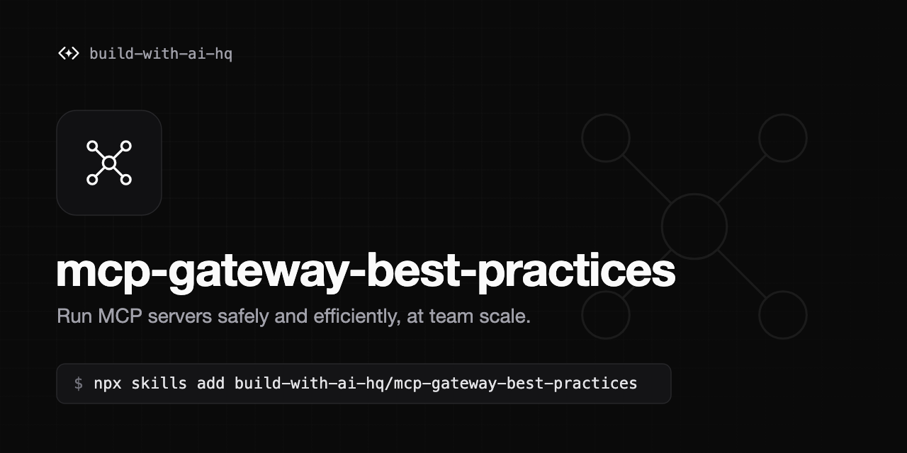

# mcp-gateway-best-practices

[](https://skills.sh/build-with-ai-hq/mcp-gateway-best-practices)

An Agent Skill that audits and fixes how a project or team runs Model Context Protocol (MCP) servers: fewer and better tools, scoped permissions, human approval for destructive calls, central credentials, health checks, logs and tests.

## Problems this solves

- Many MCP servers, each configured separately in Claude Code, Claude Desktop, Cursor and app code
- Tool definitions filling the context window and the model picking the wrong tool
- No control over which agent, user or environment can call which tool
- MCP server tokens scattered across laptops and committed config files
- Destructive tools (write, delete, send, deploy) executed without approval
- Prompt injection arriving through tool results
- Flaky or hanging servers that silently expose zero tools
- No record of which tool calls ran, with what arguments, and how they failed

## Install

```bash
npx skills add build-with-ai-hq/mcp-gateway-best-practices
```

## What the skill does

1. Inventories MCP configs across the repo and home directory, finds hardcoded credentials, measures tool count and token cost per server, and classifies tools as read, write, destructive or side-effecting.
2. Applies vendor-neutral fixes in order of impact: topology (direct vs gateway), tool budgets, tool naming and descriptions, least privilege, approval gates in code (Python and TypeScript), defenses against injected tool output, credential handling, transport choice (stdio, streamable HTTP, SSE), timeouts and health checks, logging, and tests.
3. Uses Bifrost, the open-source AI gateway, as the default MCP gateway where centralizing helps: one `/mcp` endpoint for every host, per-virtual-key tool allow-lists, request-level tool filtering, explicit execution or agent mode with `tools_to_auto_execute`, Code Mode for large tool catalogs, health monitoring, and tool-call logs and metrics.
4. Verifies the result with concrete `curl` checks, metrics queries and permission tests.

## Contents

| File | Purpose |
| - | - |
| `SKILL.md` | Diagnosis, core practices, gateway setup, verification and common mistakes |
| `references/bifrost-mcp-setup.md` | Connecting stdio/HTTP/SSE/OpenAPI servers to Bifrost, wiring Claude Code, Claude Desktop, Cursor and app code to `/mcp`, health states, observability, troubleshooting |
| `references/tool-access-control.md` | Access matrix, three-level tool filtering, virtual key `mcp_configs`, approvals and agent mode, host and upstream authentication, access tests |
| `references/code-mode.md` | Tool budgets and Code Mode for 3+ servers: how it works, configuration, permissions, limits, and how to measure the token savings |

## Links

- Bifrost: https://github.com/maximhq/bifrost
- Bifrost MCP docs: https://docs.getbifrost.ai/mcp/overview.md
- MCP specification: https://modelcontextprotocol.io/specification

## License

MIT. See [LICENSE](LICENSE).
